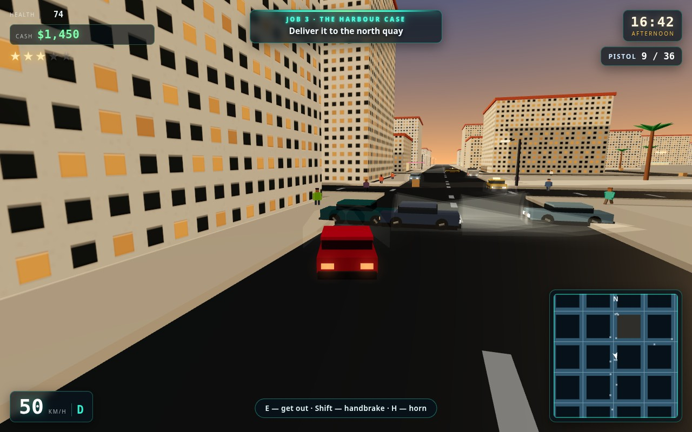
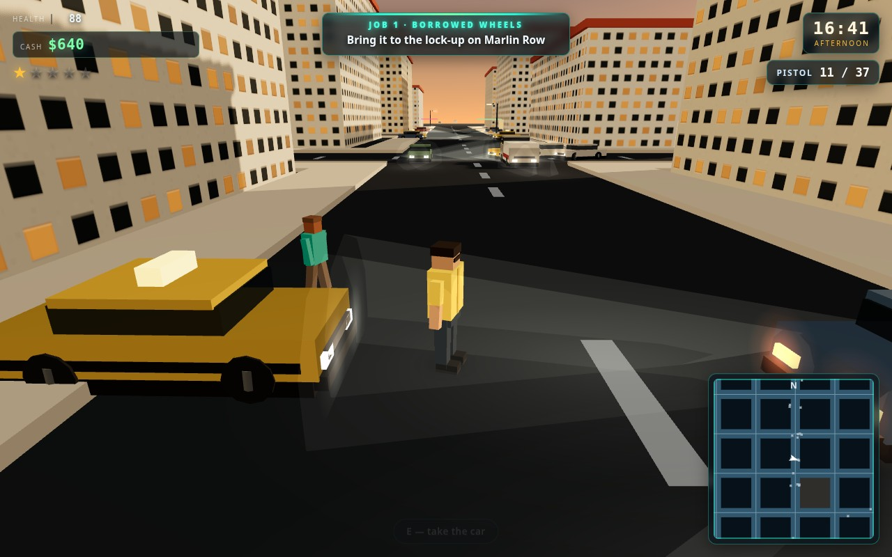
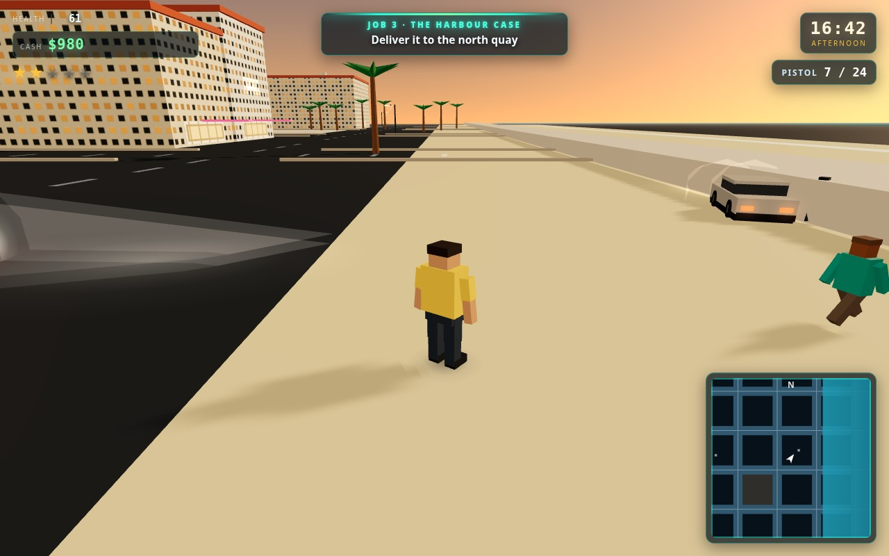
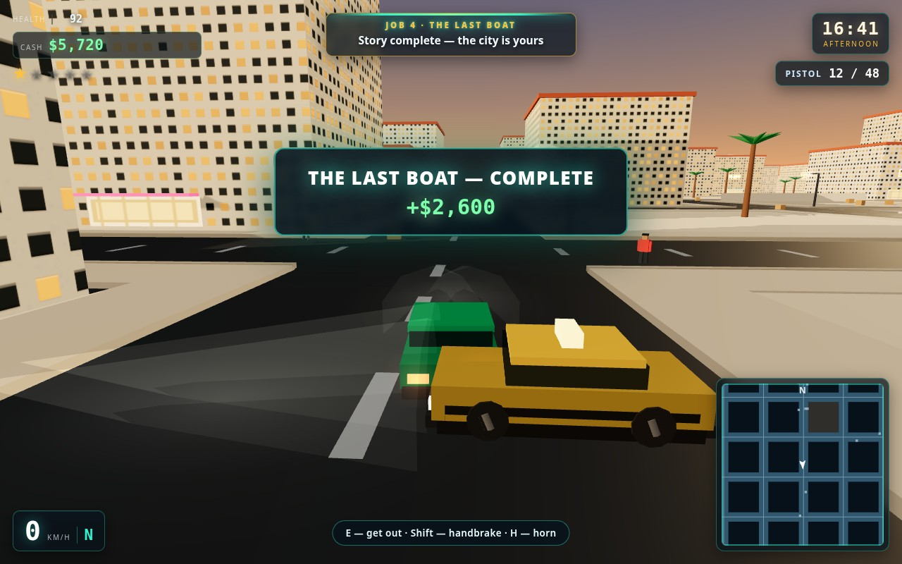

<p align="center">
  
</p>

# SOLMAR

[](https://make.fun/bounty/gta6-01)
[](https://make.fun/bounty/gta6-01)
[](https://make.fun/bounty/gta6-01)

A sun-soaked port city of whitewashed walls, terracotta roofs and turquoise water, and you have
come home with nothing. Your cousin's fishing boat is impounded over a fine nobody can explain,
the Solmar syndicate has offered to buy the debt, and the only thing you own is a borrowed jacket
and a fast right foot. Steal a car that isn't yours, run four jobs up from wheelman to waterfront
king, and buy the boat back before the syndicate owns the whole harbour. Bright, playful,
cinematic, and a little cheeky — a browser open-world game you load offline with no build step.

Built for the [make.fun gta6-01 competition](https://make.fun/bounty/gta6-01).

## Features

- **A real city, generated from a seed.** A 12×12 block grid, 15-unit roads on a 64-unit pitch,
  about 110 procedurally placed buildings with lit-window textures, terracotta roof caps and
  rooftop clutter, neon shop signs, street lamps with halos and light pools, hydrants, crates and
  bins you can knock over, and palms along the waterfront. Same seed, same city, every load.
- **A living sky.** A gradient sky-dome shader with a golden sun, and a twelve-key day ramp that
  shifts sun, hemisphere, ambient, fog and baked window/neon/lamp glow as the clock runs. The clock
  starts at 16:40 and covers a full in-game day every seven real minutes.
- **Five car classes that feel different.** A balanced sedan, a twitchy sports car, a yellow taxi
  with a roof sign, a long slow truck with a cargo box, and a dark-blue police cruiser with a white
  band and a red/blue light bar. Arcade handling: forward thrust, lateral grip that bleeds slide
  away, a handbrake that steps the tail out, steering that weakens with speed and reverses in
  reverse, skid marks, dust, smoke, body roll and a camera that tucks in behind at speed.
- **Traffic and pedestrians.** Two dozen cars keep their lane, slow into junctions, keep a gap,
  sometimes turn onto a cross street and turn around at the city edge. Thirty-four pedestrians walk
  the pavements, wander, cross at corners, and flee when a crime happens nearby or a fast car comes
  at them — and go down hard when one hits them.
- **A five-star wanted level.** Stars rise only from the crime feed (car theft, homicide, assault,
  vehicular manslaughter, assaulting an officer), one step per second so a pile-up never jumps
  straight to five. Cruisers spawn at the map edge, lead your car, ram it, and on foot close in to
  arrest. Heat decays after a quiet spell, and at zero stars every unit despawns. A siren follows
  the nearest unit's distance.
- **Four linked jobs** — steal and deliver, wreck a runner's car, run a case across town with the
  heat on, then lift the boat car and shake the tail. Glowing beacons, a green case with a glow
  column, cash payouts, a fanfare and a one-star cooldown between jobs.
- **A HUD that tells you everything at a glance.** Health bar, cash, five wanted stars, a clock with
  a phase word, a weapon chip with ammo, the objective card, a live minimap, a speedometer with a
  gear letter, context prompts, a mission-complete banner and a damage vignette.
- **All sound synthesised in the browser** with WebAudio — an engine hum that tracks speed, a
  two-tone siren that tracks police distance, a bassline that quickens under heat, and one-shots
  for gunshots, punches, crashes, pickups, job completions and the busted sting. No audio files.
- **Saves.** Pausing autosaves cash, job, step, position, heading, clock and stars to local storage,
  and tolerates private mode where storage throws.

## Run it

No build step, no dependencies to install. The game is plain static files.

```bash
node serve.ts            # serves game/ on http://localhost:8080
node serve.ts --port 9000
```

Then open <http://localhost:8080> in a desktop Chrome (or any WebGL2 browser). Click the page once
to lock the pointer and start audio, then hit **START**.

You can also serve `game/` with any static file server — just make sure `.js` comes back as
`text/javascript` so the ES module imports resolve.

The page takes two query parameters:

| query | meaning |
| --- | --- |
| `?seed=7` | rebuild the city from a different seed (default 7) |
| `?shot=chase` \| `onfoot` \| `mission` \| `night` | stage one of the four screenshot presets |

## Controls

| key | on foot | in a car |
| --- | --- | --- |
| **W A S D** / arrows | move (camera-relative) | throttle, brake, steer |
| **Shift** | sprint | handbrake |
| **Space** | jump | — |
| **E** | take the nearest car | get out |
| **F** | punch | — |
| **Left click** | fire the pistol | — |
| **R** | reload | — |
| **1** / **2** | pistol / fists | pistol / fists |
| **H** | — | horn |
| **P** / **Esc** | pause | pause |
| **M** | mute | mute |
| **Mouse** | orbit the camera | nudge the chase camera |

The pistol holds 12 rounds with 48 in reserve, fires about 300 rounds per minute and reloads in
1.4 seconds. Stealing a civilian car is one star of heat; stealing a police cruiser is two.

## The four jobs

1. **Borrowed Wheels** — steal any car and bring it to the lock-up on Marlin Row. *$450, ★*
2. **The Debt Collector** — a runner skipped a debt; find his sports car and wreck it. *$800, ★★*
3. **The Harbour Case** — pick up the case from the marina and deliver it to the north quay with
   the heat on. *$1,400, ★★*
4. **The Last Boat** — lift the sports car from the harbour deck, shake the tail until the wanted
   level is zero, and reach the hideout. *$2,600, ★★★*

Finishing all four reads **"Story complete — the city is yours"**. Starting fresh leaves you with
$250 and 100 health.

## Screenshots

All four captured from this build at 1280×800 with `tools/capture.mjs` (headless Chromium over the
DevTools protocol), each under 256 KiB.

| | |
| --- | --- |
|  |  |
| **Chase** — a red sports car mid-drift, three stars, cruisers closing | **On foot** — a damaged sedan, brake lights on, beacon down the road |
|  |  |
| **Mission** — the marina case under its beacon, two stars | **Night** — headlights, a blue light bar, a readable dark city |

## Layout

```
main.ts              the entrypoint: copies game/ + screenshots/, writes dossier.json
serve.ts             tiny static server for game/ on :8080
shots.json           the four screenshot names and their queries
game/index.html      the only page: canvas, HUD layer, overlay, import map
game/src/            plain ES modules, one responsibility each
  config.js          every tunable number and the palette
  random.js          seeded RNG and small maths helpers
  input.js           keyboard, mouse, pointer lock, scripted overrides
  audio.js           all WebAudio synthesis
  world.js           the seeded city, sky shader, lighting ramp, collision, parking
  vehicles.js        the five car classes, handling, collisions, particles
  player.js          the articulated figure, weapons, enter/exit
  traffic.js         AI traffic cars and pedestrians
  police.js          the wanted level and police response
  missions.js        the four jobs, beacons, package, banner
  hud.js             DOM HUD plus the 2D minimap
  shots.js           the four screenshot staging presets
  main.js            game loop, modes, camera, crimes, saving, title screen
game/vendor/         the vendored Three.js library (unchanged third-party code)
vendor/              the kit's dossier builder (unchanged kit plumbing)
tools/               headless helpers
  cdp.mjs            minimal DevTools-protocol driver over Node's built-in WebSocket
  capture.mjs        screenshot a page, print its state, console and requests
  playtest.mjs       the 14-step headless playtest
  verify.py          six-check verifier for a staged screenshot
  probe.mjs          boot/console/count probe
  scenemap.mjs      where the camera and the cast actually are in a shot
```

## Tools

```bash
# boot probe: errors and counts
node tools/probe.mjs http://127.0.0.1:8080/

# the 14-step headless playtest (all fourteen must pass, with no console exceptions)
node tools/playtest.mjs

# capture + verify the four screenshots
node tools/capture.mjs "http://127.0.0.1:8080/?shot=chase&seed=7" screenshots/1-chase.jpg
python3 tools/verify.py screenshots/*.jpg

# build the dossier the judge reads
mkdir -p out && MAKEFUN_OUTPUT_DIR=out node main.ts
```

`tools/verify.py` needs Pillow (`python3 -m pip install pillow`). It checks the objective card's
neon, the minimap, the top-left HUD, the sky strip, lower-half contrast and colour richness, and
exits non-zero on any failure.

## Determinism

The city, the parked cars, the traffic and the pedestrians are all placed by a seeded generator. Two
loads of `?seed=7` give byte-identical layouts; change the seed for a different city. The screenshot
presets fix the seed at 7.

## Credits

Game code written for this entry. Vendored unchanged: [Three.js](https://threejs.org) (MIT) under
`game/vendor/`, and the kit's dossier builder under `vendor/`. No other third-party code, no audio
files, no network requests at runtime.
